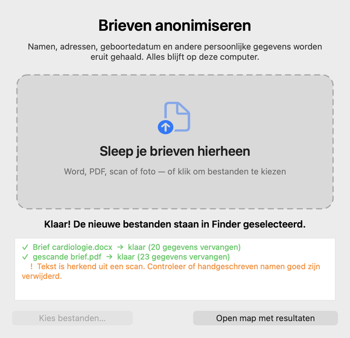

# Medisch anonimiseren

Offline macOS tool that anonymizes Dutch medical letters (Word, PDF, scans and photos) so they
can be used safely in, for example, Claude. The output is always a Word document.

**Everything happens locally on the Mac.** No network connection is used; this was verified by
blocking the network with the macOS sandbox (`sandbox-exec ... (deny network*)`).

> Language convention: code, comments and developer docs are in English. Everything the end
> user sees (app UI, the `mijn-gegevens.toml` settings file, folder and output names) is Dutch.

## Status

- [x] Phase 1: prototype (command line), tested on fake letters
- [x] Phase 2: Mac app with drop zone and Dock icon, packaged as `.app`
- [ ] Phase 3: install on the end user's Mac → see [INSTALL.md](INSTALL.md)

## The app



- Drop files on the window, the Dock icon or the icon in Finder, or click to choose them.
  Folders work too.
- When done, Finder opens with the new files selected, ready to drag into Claude.
- Results go to `~/Documents/Anonimiseren/Geanonimiseerd`.
- Menu → *Mijn gegevens bewerken…* (`⌘ ,`) opens the personal list in TextEdit; changes apply
  immediately.
- The app registers only as an *alternate* handler for Word, PDF and images
  (`LSHandlerRank = Alternate`), so it never becomes the default app for those files.
- Native window via PyObjC (no extra GUI library). Processing runs on a background thread so
  the window never freezes.

## How it works

| Input | Text extraction | Output |
|---|---|---|
| `.docx` | directly, preserving formatting (incl. headers/footers, tables, footnotes, comments) | same document with data replaced |
| `.doc`, `.rtf`, `.odt` | converted first with the built-in macOS tool `textutil` | same |
| `.pdf` (digital) | text layer via pypdfium2 | new Word document |
| `.pdf` (scan) | per-page OCR with **Apple Vision** (built into macOS, Dutch) | new Word document |
| `.jpg` `.png` `.heic` `.tiff` | Apple Vision | new Word document |

Then:

1. **deduce** (rule-based, built for Dutch medical text) finds names, addresses, institutions,
   dates, ages, BSN, patient numbers, phone numbers, e-mail addresses and URLs.
2. **Personal list** (`mijn-gegevens.toml`): names of the patient, family and doctors, the address
   and fixed numbers are always found, in any spelling (case, extra whitespace).
3. **Extra cleanup passes** on top of deduce:
   - loose initials next to a name are included (`J.P. de Vries`, not just `J.`)
   - the date of birth is always removed, even when dates are kept (the default)
   - someone else whose initial happens to match the patient's is not labelled `[PATIENT]`
   - short mentions ("collega Jansen") get the same number as the full name
   - other **dates are kept by default** so the timeline stays readable; set
     `data_vervangen = true` in `mijn-gegevens.toml` to replace them too
4. **Replacement** with labels: `[PATIENT]`, `[PERSOON-1]`, `[LOCATIE-2]`, `[DATUM-1]`, …
   The same person gets the same number throughout the document, so Claude can still follow
   the letter. (Labels are deduce's Dutch tags.)
5. **Hidden Word content**: text is collected from *every* XML part of the `.docx`, not only the
   visible paragraphs: field codes (`HYPERLINK "mailto:…"`), simple fields, document variables,
   content controls, form fields, SmartArt, charts and legacy WordArt.
6. **Metadata cleanup** (Word): author, title, company, authors of comments and tracked changes,
   `people.xml` (comment authors' names and account ids), image alt text, hyperlink targets,
   deleted text from track changes. The **file name** is anonymized too.
7. **Safety net** (Word): every original value that was found is searched again in all text,
   attribute values and external link targets of the whole package, and replaced there too.
8. **OCR fallback**: when Apple Vision fails on the Neural Engine (seen on some Macs), it retries
   on the CPU and remembers that for the next pages; if OCR fails completely on a PDF page with a
   text layer, that text layer is used, with a warning.
9. **PDF pages that are (partly) a scan** are OCR'd: pages with hardly any text, but also pages
   where images cover ≥30% of the page (e.g. a portal printout header over a scanned letter).

### Known limitations

- Text **inside images embedded in a Word file** (e.g. a scanned signature) and the contents of
  **embedded objects** (e.g. an Excel sheet) are not checked; the app warns when a document
  contains them.
- Handwriting and poor scans: Apple Vision can make mistakes (e.g. `1dd` → `Idd`). A misread
  name may not be recognized. The app warns for scans.
- Anonymization is never 100% (the deduce authors say so too). The personal list makes it much
  more reliable; a quick look at the result remains wise.
- For `.doc`, headers and footers are lost during conversion (a `textutil` limitation).
- Apple Silicon (arm64) and macOS 14+ only.

## Project layout

```
src/anonymizer/
  engine.py      deduce + personal list + cleanup passes → replacements
  settings.py    reads mijn-gegevens.toml (Dutch, user-facing)
  readers.py     PDF text / OCR, legacy Word conversion
  ocr.py         Apple Vision OCR
  word.py        in-place .docx anonymization, text → .docx
  pipeline.py    process one file / collect files from folders
  app.py         the Mac app (PyObjC)
  __main__.py    command line
tests/
  make_samples.py   fake letters (docx, doc, text PDF, scanned PDF, photo)
  check.py          end-to-end check incl. leak scan of the raw .docx XML
  render_window.py  renders the app window to a PNG
scripts/
  build_app.sh   builds dist/Anonimiseren.app + .zip
  make_icon.py   draws the app icon
```

## Development

Requires Python 3.12 (`/opt/homebrew/bin/python3.12`).

```bash
python3.12 -m venv .venv
.venv/bin/pip install --no-index --find-links wheels --require-hashes -r requirements.lock
```

Process files from the command line (output defaults to `~/Documents/Anonimiseren/Geanonimiseerd`):

```bash
PYTHONPATH=src .venv/bin/python -m anonymizer path/to/file-or-folder
```

Options: `--out DIR`, `--settings FILE`, `--show` (prints what was replaced — **shows
confidential data**, testing only).

End-to-end check: creates fake letters (incl. one with personal data hidden in field codes,
`people.xml`, SmartArt, a document variable and a comment, and a PDF with a digital header over
a scan), processes them, searches every part of the output `.docx` for leftover data, and runs
unit checks (near-identical dates, lowercase common words, invalid settings file, unreadable
folders):

```bash
.venv/bin/python -I tests/check.py
```

Build the app (fully offline, only from `wheels/` and `build-wheels/`, with hashes):

```bash
./scripts/build_app.sh   # → dist/Anonimiseren.app and dist/Anonimiseren.zip
```

Ad-hoc signed, not notarized; see INSTALL.md for the one-time Gatekeeper step.

### Pull requests

Conventional Commits and the PR template in
[.github/pull_request_template.md](.github/pull_request_template.md). With Claude Code, run
`/pr-message` to generate the title and description
([.claude/skills/pr-message](.claude/skills/pr-message/SKILL.md)).

## Dependencies and security

All packages are stored as wheels in [`wheels/`](wheels/) and installed only from there, verified
by SHA-256 ([`requirements.lock`](requirements.lock)). Nothing is downloaded when installing or
building. The same applies to the build tooling in [`build-wheels/`](build-wheels/)
([`build-requirements.lock`](build-requirements.lock)).

**Audit of deduce 3.0.6 + docdeid 1.0.1** (2026-11-15):

- The PyPI wheels are file-for-file identical to the GitHub tags `vmenger/deduce@v3.0.6` and
  `vmenger/docdeid@v1.0.1`; RECORD hashes match.
- ~4,700 lines of Python + lookup lists (plain text). No `socket`/`urllib`/`requests`/
  `subprocess`/`eval`/`exec`.
- Points of attention (no risk in this setup):
  - deduce needs a cache (`pickle`, ~77 MB). `scripts/build_app.sh` prebuilds it into the app
    (offline); on first start it is copied to `~/Library/Caches/Anonimiseren`, so deduce never
    writes into the signed app bundle. The app also never writes `.pyc` files into its bundle
    (precompiled at build time), which would break the code signature.
  - `importlib` loads classes named in the config; only the bundled config is used.
  - deduce sets logging to DEBUG on import; we reset it. Document text is never logged.

**py2app 0.28.10** (build tool): the bootstrap code it puts inside the app contains no network
code; its only `exec` runs our own entry script.

Updating = repeat the same audit, then replace the wheel in `wheels/` and regenerate
`requirements.lock`.

Other dependencies: python-docx (+lxml), pypdfium2, Pillow, PyObjC (Vision, Cocoa, Quartz),
numpy, rapidfuzz, regex, frozendict.

deduce license: LGPL-3.0-or-later.

## Credits

This project was co-authored with AI (Claude Code, by Anthropic). The checks in the
Development section are how the code is verified.
